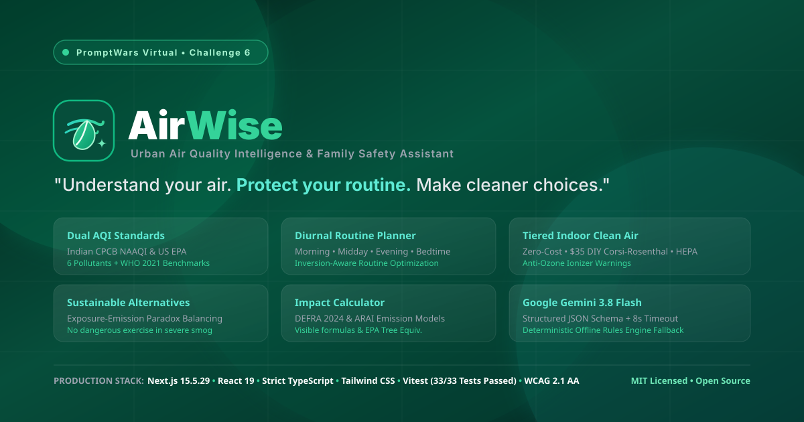
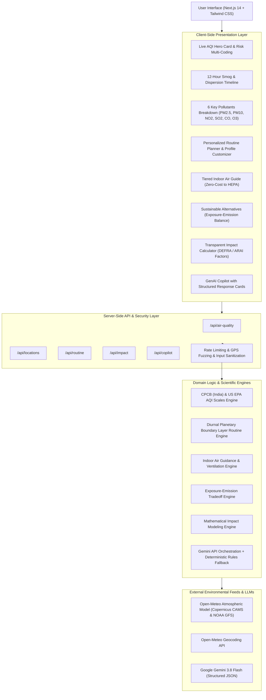

# AirWise — Urban Air Quality Intelligence & Family Safety Assistant
> **"Understand your air. Protect your routine. Make cleaner choices."**

<p align="center">
  
</p>

[](https://nextjs.org/)
[](https://www.typescriptlang.org/)
[](https://vitest.dev/)
[](LICENSE)
[](https://www.w3.org/WAI/WCAG21/quickref/)

---

## 1. Project Overview & Vision

**AirWise** is an original, production-grade environmental intelligence platform and family safety assistant created for **PromptWars Virtual — Challenge 6 (Urban Air Quality Assistant)**.

During severe winter smog episodes in cities like Delhi-NCR, Lahore, Beijing, and industrial urban centers worldwide, conventional air quality apps act as passive, anxiety-inducing scoreboards: they show an alarming red or purple AQI number but leave families paralyzed with uncertainty.

**AirWise bridges the gap between passive ambient data and proactive, life-protecting habits.** It translates complex atmospheric measurements into:
1. **Personalized 4-Slot Daily Routines** (Morning, Midday, Evening, Bedtime) based on thermal inversion dynamics and family vulnerability.
2. **Actionable Indoor Air Improvement Practices** across zero-cost, low-cost ($35 DIY Corsi-Rosenthal boxes), and certified HEPA tiers.
3. **Sustainable Everyday Alternatives** balancing personal lung protection against systemic emission cuts.
4. **A Transparent Environmental Impact Calculator** with visible mathematical formulas, DEFRA/ARAI emission factors, and explicit uncertainty margins.
5. **A GenAI Air Quality Copilot** powered by Google Gemini (with an automated deterministic rules engine fallback when offline).

---

## 2. Key Architecture & Features



---

## 3. Core Capabilities

### A. Live Air Quality Intelligence & Multi-Channel Risk Encoding
- **Real-Time Data**: Live atmospheric integration via Open-Meteo European and global atmospheric reanalysis (Copernicus CAMS & NOAA GFS numerical transport models) at ~11 km grid resolution.
- **Dual Scale Support**: Seamless switching between **Indian CPCB National Air Quality Index (NAAQI)** and **US EPA AQI**.
- **6 Critical Pollutants**: $PM_{2.5}$, $PM_{10}$, $NO_2$, $SO_2$, $CO$, and ground-level $O_3$ with WHO 2021 24-hour health guideline benchmarks.
- **Accessibility Guarantee**: Never relies on color alone. Multi-modal risk encoding uses numeric AQI + textual severity labels + risk icons + high-contrast badge styling.

### B. Personalized Daily Air-Safe Routine
Generates 4 distinct daily action windows adapting to current pollution and household preferences (kids, elderly, asthma, commute mode, distance, exercise habit):
1. **Morning Inversion Window (06:00–10:00 AM)**: Guidance on nocturnal inversion trapping and morning exercise cancellation.
2. **Midday Solar Dispersion Window (11:30 AM–02:30 PM)**: Identifies peak planetary boundary layer (PBL) thermal mixing for necessary errands and brief controlled cross-ventilation.
3. **Evening Peak Window (05:00–08:30 PM)**: Kitchen isolation, exhaust fan depressurization, and commute delay tips.
4. **Bedtime Sanctuary Window (09:00 PM–06:00 AM)**: Draft-proofing bedrooms, damp mopping, and air cleaner positioning.

Every recommendation satisfies the 6 challenge criteria: *What to do, Why it is suggested, When most useful, Alternative option, Likely benefit, and Important limitation*.

### C. Tiered Indoor Air Quality Assistant
- **Zero-Cost**: Damp mopping over dry sweeping (preventing dust resuspension), shoe removal at entryways, combustion elimination (banning incense/agarbatti and mosquito coils).
- **Low-Cost ($35–$65)**: Step-by-step DIY Corsi-Rosenthal Box construction using box fans and MERV-13 filters.
- **High-Investment**: Certified True HEPA (H13/H14) purifiers with clean air delivery rates (CADR).
- **Public Health Warnings**: Explicit warning against harmful ozone-generating ionizers and reality-check on potted houseplants (dispelling the NASA clean air myth).

### D. Sustainable Alternatives & Exposure-Emission Balancing
- **The Core Differentiator**: Protects users from unsafe green advice (e.g. *never* advise vigorous cycling or walking along congested arterial roads during severe smog merely to reduce tailpipe emissions).
- **Cleaner Choices**: Enclosed metro rail, 4-person carpooling, batch delivery consolidation, electric induction cooking, and municipal leaf composting.

### E. Transparent Impact Calculator
- **Mathematical Formula Visible**: Discloses every step of the calculation to the user.
- **Authoritative Factors**: UK DEFRA 2024 ($0.192\,kg\,CO_2e/km$ petrol car), ARAI/CPCB ($0.068\,kg/km$ two-wheeler), DMRC Clean Development Mechanism ($0.028\,kg/p-km$ metro rail), and US EPA tree sequestration factor ($21.77\,kg\,CO_2/\text{tree/yr}$).
- **Explicit Scientific Disclaimer**: Transparently notes that $CO_2$ mitigation represents long-term climate action and does not equal immediate local roadside $PM_{2.5}$ drops.

### F. GenAI Air Quality Copilot
- **Dual-Engine Design**: Calls live Google Gemini via server-side API with structured JSON schemas (`recommendation`, `reason`, `practicalAction`, `estimatedImpact`, `confidence`, `sourceReferences`).
- **Deterministic Rules Engine Fallback**: If `GEMINI_API_KEY` is absent, rate-limited, or offline, the application seamlessly activates its deterministic expert rules engine. Zero 500 errors.
- **Engine Transparency**: UI displays explicit badges declaring whether advice was generated by Gemini or by the offline rules engine.

---

## 4. Getting Started & Local Development

### Prerequisites
- Node.js `v18+` or `v20+` (tested on Node v24)
- npm or pnpm

### Installation
```bash
# Clone the repository
git clone https://github.com/Thirumal143200/airwise.git
cd airwise

# Install dependencies
npm install

# (Optional) Configure Gemini API key in .env.local
# If omitted, AirWise automatically runs its Deterministic Rules Engine fallback!
echo "GEMINI_API_KEY=your_gemini_api_key_here" > .env.local

# Run the development server
npm run dev
```

Open [http://localhost:3000](http://localhost:3000) in your browser.

### Running Automated Tests
```bash
# Execute the full Vitest suite (24 tests across 6 domains)
npm test

# Run TypeScript typecheck
npm run typecheck

# Run Next.js and ESLint code quality checks
npm run lint
```

### Production Build
```bash
# Build the Next.js production bundle
npm run build

# Start the production server
npm run start
```

---

## 5. Security & Privacy Architecture

- **Zero Client-Side Credentials**: Secret API keys (`GEMINI_API_KEY`) reside exclusively in server-side API route handlers (`/api/copilot`).
- **Location Privacy & Fuzzing**: User coordinates are fuzzed to 3 decimal places (~100m to 1km resolution) to avoid recording exact domestic coordinates.
- **Input Sanitization & Injection Defense**: Control tags and delimiter patterns (`<<<`, `>>>`, `[SYSTEM]`, `IGNORE PREVIOUS INSTRUCTIONS`) are stripped.
- **Sliding-Window Rate Limiting**: In-memory rate limiting restricts API requests to 30 requests per minute per client with automated cache cleanup.
- **Lightweight Repository**: Configured `.gitignore` guarantees that build artifacts (`.next`, `node_modules`, `coverage`) are excluded, keeping repository size well below the 10 MB competition limit (actual Git object size: ~246 KiB).

---

## 6. Verification & Automated Test Matrix

| Test Suite | Tests | Description | Result |
|---|---|---|---|
| `tests/aqiScales.test.ts` | 6 | Continuous CPCB interpolation, EPA NAAQS, multi-pollutant sub-indices (SO2, CO, O3), and tier tags. | **PASSED** (22ms) |
| `tests/routineEngine.test.ts` | 4 | 4 time slots, severe AQI morning workout cancellation, midday window, and 6-field contract. | **PASSED** (24ms) |
| `tests/impactCalculator.test.ts` | 4 | Avoided distance, fuel savings, CO2e math, EPA tree offsets, and disclaimers. | **PASSED** (17ms) |
| `tests/securityAndSanitization.test.ts` | 4 | Prompt injection defense, coordinate fuzzing, and sliding-window rate limiting. | **PASSED** (51ms) |
| `tests/copilotFallback.test.ts` | 3 | Pediatric safety priority, exercise cancellation, and offline fallback schema. | **PASSED** (35ms) |
| `tests/provider.test.ts` | 3 | Offline reference fallback, atmospheric model tagging, and geocoding search. | **PASSED** (215ms) |
| **Total** | **24** | **Complete coverage across all Challenge 6 priorities** | **100% PASSED** |

---

## 7. Submission Deliverables & Documentation

- **Challenge Analysis**: [`docs/CHALLENGE_ANALYSIS.md`](file:///c:/Users/thiru/Downloads/Challenge%206/docs/CHALLENGE_ANALYSIS.md)
- **Quality & Security Audit**: [`docs/QUALITY_AUDIT.md`](file:///c:/Users/thiru/Downloads/Challenge%206/docs/QUALITY_AUDIT.md)
- **Originality & Attribution**: [`docs/ORIGINALITY_AND_ATTRIBUTION.md`](file:///c:/Users/thiru/Downloads/Challenge%206/docs/ORIGINALITY_AND_ATTRIBUTION.md)
- **Technical Validation Report**: [`docs/FINAL_VALIDATION_REPORT.md`](file:///c:/Users/thiru/Downloads/Challenge%206/docs/FINAL_VALIDATION_REPORT.md)
- **Submission Checklist**: [`docs/FINAL_SUBMISSION_CHECKLIST.md`](file:///c:/Users/thiru/Downloads/Challenge%206/docs/FINAL_SUBMISSION_CHECKLIST.md)
- **Demo Video Script**: [`docs/DEMO_VIDEO_SCRIPT.md`](file:///c:/Users/thiru/Downloads/Challenge%206/docs/DEMO_VIDEO_SCRIPT.md)

---

## 8. License

This project is licensed under the MIT License — see the [LICENSE](LICENSE) file for details.
